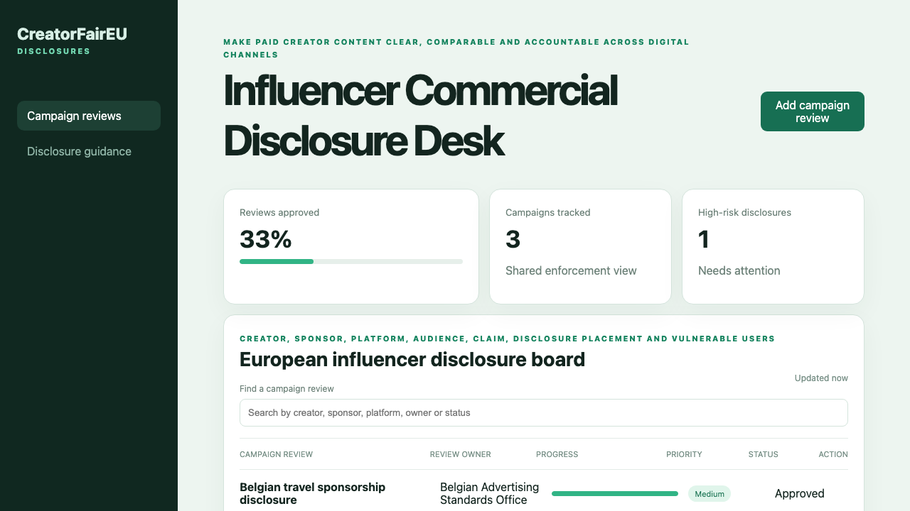

# Influencer Commercial Disclosure Desk

## One-sentence benefit

Help creators, agencies and authorities review commercial-content disclosures consistently across digital channels.

## Live demo

[Watch the workflow](docs/demo.webm).

## Screenshots

## Main features

- Search and sort campaigns by creator, sponsor, owner or status.
- Create campaign reviews through the Java API.
- Advance reviews through draft, review and approved states.
- Show loading, empty, error and success feedback.
- Provide operational and guidance routes responsively.

## Technology used

Vue, TypeScript, Pinia, Vue Router, Vite, Spring Boot and Java 21.

## Installation instructions

Install Node.js 22 and Java 21. Run `npm install`, start `cd backend && mvn spring-boot:run`, then run `npm run dev`.

## Commercial licensing/contact

Commercial licensing and integration support are available through the repository contact options.

## Business problem and users

Consumer teams, advertising bodies, platforms, agencies and creators need clear sponsorship labels and substantiated claims.

## Key workflows

Find a campaign, add a review, assess disclosure risk, advance readiness and confirm the API result.

## Vue framework highlights

Pinia manages derived operational state, Vue Router provides multiple views and reactive actions perform real API writes.

## Java backend highlights

Spring Boot exposes validated list, search, create and update APIs, clear errors, health status and service tests.

## Architecture and state flow

Vue calls `/api/items`; Java validates requests and returns records that Pinia shares across routed views.

## Accessibility and responsive behaviour

Semantic controls, labelled search, visible focus styles and responsive tables support keyboard and small screens.

## Verification commands

Run `npm test`, `npm run build`, `cd backend && mvn test` and `cd backend && mvn package`.

## Structure

`src` contains the frontend, `backend` contains Java and `docs` contains inspected media.

## Tradeoffs

In-memory records simplify local use; production needs identity, persistence and platform-monitoring integrations.

## Roadmap

Add evidence capture, claim verification, minor-audience safeguards, multilingual labels and coordinated enforcement.
